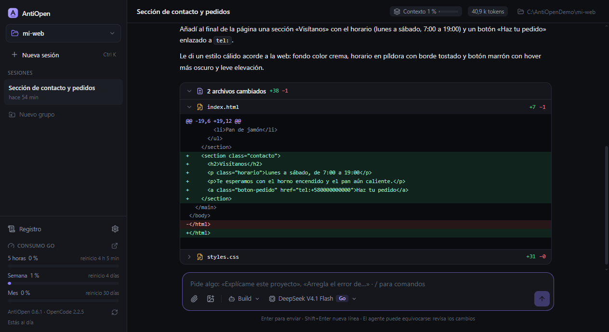
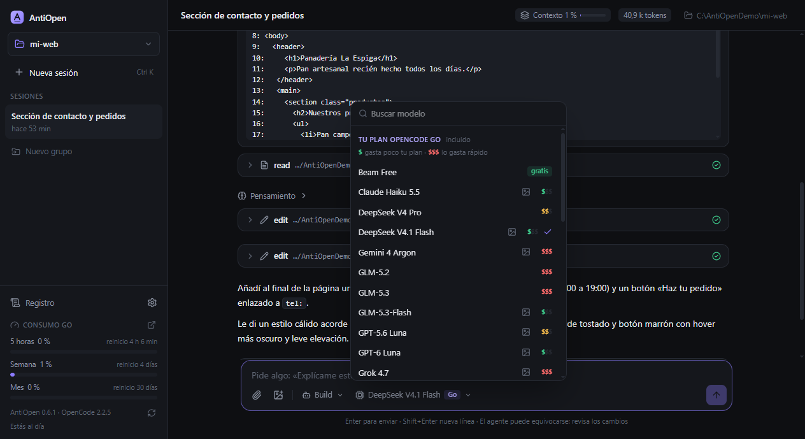
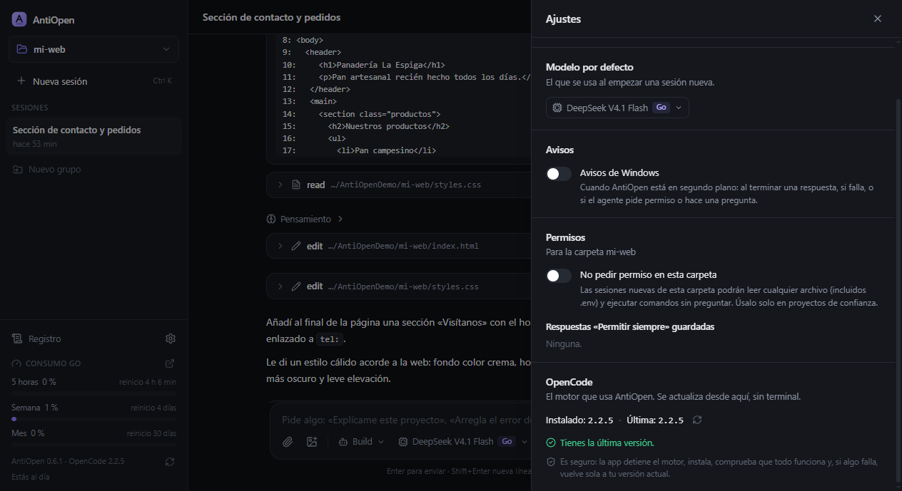

# AntiOpen

**Un agente de programación con interfaz de escritorio, sobre el motor de OpenCode.**

Abre una carpeta, pídele algo y mira lo que hace: qué archivos lee, qué cambia y qué comandos ejecuta. Si no te gusta, lo deshaces.

### [Descargar AntiOpen para Windows](https://github.com/ronsf30/antiopen-releases/releases/latest)

 

## Por qué existe

[OpenCode](https://opencode.ai) es un agente de programación muy capaz y, con el plan **OpenCode Go**, da acceso a muchos modelos por una cuota fija. Pero se usa desde la terminal, y ahí cuesta seguirle el ritmo: qué archivo tocó, qué comando lanzó, cuánto plan llevas gastado, cómo volver atrás.

Herramientas como Antigravity demostraron que trabajar con un agente se disfruta mucho más en una aplicación de escritorio. AntiOpen junta las dos cosas: **la experiencia de una app de escritorio con el motor de OpenCode y tu plan Go**. El nombre es un guiño a Antigravity.

No reemplaza a OpenCode: lo usa por debajo. Tus sesiones, tu clave y tu configuración siguen siendo las de OpenCode, así que también las ves desde la terminal si quieres.

## Qué hace

**Trabajar con el agente**
- Abre la carpeta de tu proyecto y conversa: la respuesta aparece mientras se escribe, con código resaltado y botón para copiar.
- Ves cada paso del agente: archivos leídos, cambios, comandos y su razonamiento, en bloques plegables.
- Al terminar cada respuesta, una tarjeta muestra **qué archivos cambió**, con su diff.
- **Deshacer desde aquí** en cualquier mensaje tuyo: quita lo que vino después y restaura los archivos.
- Permisos con botones: *Permitir una vez*, *Permitir siempre* o *Rechazar*.
- Adjunta archivos e imágenes (botón, pegar o arrastrar).
- Escribe mientras trabaja: **Enter** deja tu mensaje en cola; **Alt+Enter** le corrige el rumbo al momento.
- Comandos de OpenCode escribiendo `/`.

**Tu plan, bajo control**
- **Medidor de consumo de OpenCode Go**: ventana de 5 horas, semana y mes, con cuándo se reinicia cada una.
- Selector de modelos con los de **tu plan Go primero**. Los que se cobran aparte quedan separados y piden confirmación.
- Cada modelo indica cuánto gasta tu plan (`$`, `$$`, `$$$` o *gratis*) y si acepta imágenes.
- Indicador de **contexto** de cada conversación, con botón para resumirla cuando se llena.

**Organización**
- Sesiones por carpeta, con búsqueda, **grupos** y nombres editables.
- **Exportar e importar sesiones** con todo su historial, para pasarlas a otro PC.
- Registro de errores explicado en palabras claras, listo para copiar, con las claves ocultas.
- Avisos de Windows cuando termina una tarea o necesita tu respuesta.
- Tema claro, oscuro o el del sistema.

<table>
  <tr>
    <td width="50%"></td>
    <td width="50%"></td>
  </tr>
  <tr>
    <td align="center">Modelos de tu plan Go, con su nivel de gasto</td>
    <td align="center">Ajustes y actualización segura de OpenCode</td>
  </tr>
</table>

## Instalar

1. Descarga `AntiOpen-Setup-x.y.z.exe` desde la [última versión](https://github.com/ronsf30/antiopen-releases/releases/latest) y ábrelo.
2. Si Windows muestra **"Windows protegió su PC"**, pulsa **Más información → Ejecutar de todas formas**. Aparece porque el instalador no está firmado con un certificado de pago; no es un virus.
3. Abre AntiOpen:
   - Si el PC no tiene OpenCode, pulsa **Instalar OpenCode** y la app se encarga (Node.js incluido si hace falta). Si prefieres la terminal: `npm.cmd install -g @opencode/cli`.
   - Pega tu clave de OpenCode Go cuando te la pida. En la [consola de OpenCode](https://opencode.ai/console), pon la región en **Global** (pestaña Go → *Manage privacy*).
4. Pulsa **Abrir carpeta**, elige tu proyecto y empieza.

**Necesitas:** Windows 10 u 11 de 64 bits y un plan de [OpenCode Go](https://opencode.ai) (o cualquier otro proveedor que tengas configurado en OpenCode). Para ver los cambios y deshacerlos, la carpeta necesita git; si no lo tiene, la app ofrece activarlo.

## Actualizaciones

- **AntiOpen se actualiza solo.** Busca versiones nuevas al abrirse y cada pocas horas, las descarga en segundo plano y te muestra **Reiniciar para actualizar**.
- **OpenCode se actualiza desde la app** (Ajustes → OpenCode). Antes de terminar comprueba que la versión nueva funciona, y si algo falla vuelve sola a la anterior.

## Privacidad y seguridad

- **Tu clave no pasa por aquí.** AntiOpen se la entrega a OpenCode, que la guarda en tu PC. No va en el instalador ni en este repositorio.
- AntiOpen arranca su propio servidor de OpenCode solo en tu equipo (`127.0.0.1`), con una contraseña nueva en cada arranque que nunca sale de la app.
- Tus conversaciones van únicamente al proveedor del modelo que elijas, como cuando usas OpenCode directamente.
- Este repositorio solo contiene los instaladores. El código fuente es privado.

## Preguntas frecuentes

<b>Me sale "Insufficient account funds"</b>

Elegiste un modelo que no está en tu plan Go (por ejemplo de OpenCode Zen, que se paga aparte con saldo). Abre el selector de modelos y elige uno de la sección **Tu plan OpenCode Go**.

<b>Me sale "This Go model requires Global regions"</b>

En la [consola de OpenCode](https://opencode.ai/console): pestaña **Go → Manage privacy → Global**.

<b>No veo qué archivos cambió el agente ni puedo deshacer</b>

OpenCode necesita que la carpeta tenga git para seguir los cambios. AntiOpen te ofrece activarlo con un botón. Abre siempre la carpeta de un proyecto concreto, no una carpeta que contenga muchos proyectos.

<b>¿Puedo usar mis sesiones en otro PC?</b>

Sí: menú de la carpeta → **Exportar sesiones de esta carpeta**, y en el otro PC → **Importar sesiones**.

<b>Algo falló y no sé por qué</b>

Abre **Registro** en la barra lateral. Cada error viene explicado y clasificado (*Pasajero*, *Configuración* o *Importante*), con un botón para copiar el detalle.

## Versiones

Todas las versiones, con sus notas, están en [Releases](https://github.com/ronsf30/antiopen-releases/releases).

---

AntiOpen es un proyecto independiente: no es un producto oficial de OpenCode ni de Antigravity. OpenCode es de sus respectivos autores, en <a href="https://opencode.ai">opencode.ai</a>.

